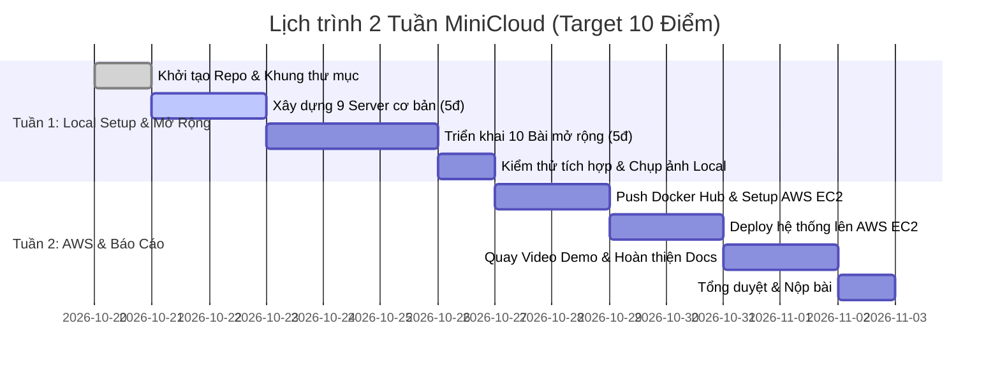

# 🚀 KẾ HOẠCH TRIỂN KHAI DỰ ÁN MINICLOUD (2 TUẦN - MỤC TIÊU 10 ĐIỂM)

- **Thời gian:** 14 ngày (2 tuần).
- **Mục tiêu:** 
  - Đạt trọn vẹn **10/10 điểm** (5 điểm chuẩn hóa 9 Server cơ bản + 5 điểm toàn bộ 10 bài tập mở rộng).
  - Đẩy ít nhất 1 custom image lên **Docker Hub**.
  - Triển khai hoạt động ổn định trên **AWS EC2 (Ubuntu)** với Public IP.
  - Hoàn thiện Báo cáo 5 Chương chuẩn mẫu + Video Demo.
- **Quy mô nhóm:** 2 Thành viên.

---

## 👥 PHÂN VAI & TRÁCH NHIỆM CHÍNH

| Vai trò | Phụ trách chính | Trọng tâm công việc |
| :--- | :--- | :--- |
| **Thành viên A** | **Infra, Security & Monitoring** | - Cấu hình Bind9 DNS (Cơ bản + Mở rộng).<br>- Cấu hình Prometheus + Node Exporter + Scrape Web.<br>- Cấu hình Grafana Dashboard cá nhân (CPU, RAM, Net).<br>- Cấu hình Keycloak OIDC, Realm, Client, Token.<br>- Cấu hình API Gateway Nginx + Load Balancer Round Robin 2 Web.<br>- Setup hạ tầng AWS EC2, Swap RAM, Security Groups. |
| **Thành viên B** | **Application, Data & Storage** | - Xây dựng Web Server 1 & Web Server 2 (HTML + Blog cá nhân 3 bài).<br>- Xây dựng Backend Flask API (`/hello`, `/student`, `/students-db`, `/secure`).<br>- Khởi tạo MariaDB RDS (DB `minicloud` + `studentdb`).<br>- Cấu hình MinIO Object Storage (Buckets: `demo`, `profile-pics`, `documents`).<br>- Đóng gói & Push Image lên Docker Hub.<br>- Tổng hợp báo cáo, chụp ảnh minh chứng & kịch bản demo. |

---

## 📅 TIMELINE CHI TIẾT 14 NGÀY



---

### 🟢 TUẦN 1: LOCAL ENVIRONMENT & HOÀN THIỆN TOÀN BỘ CODE (CƠ BẢN + MỞ RỘNG)

#### Ngày 1: Setup Repository & Khung dự án
- **Thành viên A:** Tạo GitHub repository, add bạn B làm Collaborator, push file `.gitignore`, cấu trúc nhánh (`main`, `dev`).
- **Thành viên B:** Clone repo về máy, tạo cấu trúc thư mục 9 server chuẩn:
  - `web-frontend-server` (và bản sao `web-frontend-server2`)
  - `application-backend-server`
  - `relational-database-server`
  - `authentication-identity-server`
  - `object-storage-server`
  - `internal-dns-server`
  - `monitoring-prometheus-server`
  - `monitoring-grafana-dashboard-server`
  - `api-gateway-proxy-server`
- **Output Ngày 1:** Khung thư mục đẩy lên GitHub, cả 2 pull về thành công.

#### Ngày 2 - 3: Hoàn thành 9 Container Cơ Bản (Mốc 5 Điểm)
- **Thành viên A:**
  - Viết cấu hình Bind9 DNS (`named.conf.options`, `named.conf.local`, `db.cloud.local`).
  - Viết cấu hình Prometheus (`prometheus.yml`) scrape `monitoring-node-exporter-server:9100`.
  - Khởi chạy Grafana, cấu hình kết nối datasource Prometheus.
  - Viết cấu hình Nginx Gateway (`nginx.conf`) map `/`, `/api/`, `/auth/`.
- **Thành viên B:**
  - Viết Web Server (`Dockerfile`, `conf.default`, `index.html`, `/blog/index.html`).
  - Viết Flask Backend (`app.py`, `Dockerfile` với `/hello`).
  - Viết MariaDB script (`001_init.sql` tạo DB `minicloud`, bảng `notes`).
  - Cấu hình MinIO (`docker-compose.yml`), kiểm tra Console port 9001.
- **Output Ngày 3:** Chạy `docker compose up -d`, kiểm tra thông mạng `cloud-net` giữa 9 container.

#### Ngày 4 - 6: Hoàn thành Trọn Vẹn 10 Bài Tập Mở Rộng (Mốc 10 Điểm)
- **Thành viên B:**
  1. **Web Frontend (0.5đ):** Viết 3 bài blog cá nhân (`blog1.html`, `blog2.html`, `blog3.html`) kèm ảnh minh họa và hyperlink điều hướng.
  2. **App Backend API (0.5đ):** Tạo `students.json` (5 SV) và route `@app.get("/student")`.
  3. **Database Relational (0.5đ):** Tạo DB `studentdb`, bảng `students` (3 bản ghi), viết route `@app.get("/students-db")` trong Flask để query dữ liệu thực tế từ MariaDB.
  4. **MinIO Object Storage (0.5đ):** Tạo bucket `profile-pics` (upload `avatar.jpg`, set public policy), tạo bucket `documents` (upload file PDF).
- **Thành viên A:**
  5. **Keycloak OIDC (0.5đ):** Tạo realm `realm_<MSSV>`, tạo 2 user (`sv01`, `sv02`), tạo client `flask-app`, test lấy JWT token và gọi route `/secure`.
  6. **Internal DNS (0.5đ):** Cập nhật `db.cloud.local` thêm bản ghi A cho `app-backend`, `minio`, `keycloak`. Test qua `dig`.
  7. **Prometheus Scrape Web (0.5đ):** Cập nhật `prometheus.yml` scrape thêm `web-frontend-server:80`.
  8. **Grafana Custom Dashboard (0.5đ):** Tạo dashboard cá nhân `System Health of <MSSV>` với 3 panel: CPU, RAM, Network Traffic.
  9. **API Gateway Routing (0.5đ):** Cập nhật Nginx route `/student/` trỏ tới `/student` của Backend.
  10. **Load Balancer Round Robin (0.5đ):** Thêm service `web-frontend-server2`, cấu hình `upstream` trong Nginx để cân bằng tải luân phiên giữa 2 web.

#### Ngày 7: Kiểm thử toàn diện trên Local & Lưu trữ minh chứng
- Cả 2 cùng chạy kịch bản kiểm thử:
  - Test Ping 9 container qua `cloud-net`.
  - Test curl qua Gateway port 80 cho tất cả endpoints.
  - Test Round Robin qua trình duyệt.
- Chụp ảnh màn hình đợt 1 (lưu trữ phục vụ viết báo cáo).

---

### 🔵 TUẦN 2: DOCKER HUB, AWS EC2, QUAY VIDEO DEMO & BÁO CÁO

#### Ngày 8 - 9: Push Docker Hub & Setup AWS EC2
- **Thành viên B:**
  - Đăng nhập Docker Hub, build và push image tùy biến:
    ```bash
    docker build -t <dockerhub_username>/myminicloud-web:v1 ./web-frontend-server
    docker push <dockerhub_username>/myminicloud-web:v1
    ```
  - Cập nhật `docker-compose.yml` để sử dụng image từ Docker Hub.
- **Thành viên A:**
  - Đăng nhập AWS Console, tạo EC2 Instance: **Ubuntu 22.04 LTS** (Khuyên dùng `t3.small` hoặc `t3.micro`).
  - **Cấu hình Security Group (Inbound Rules):** Mở Port `22` (SSH), `80` (Proxy/Web), `8080`, `8081`, `8085`, `3000`, `9000`, `9001`, `9090`, `1053`.
  - **Cực kỳ quan trọng (Tránh lỗi sập RAM do Keycloak):** Bật 4GB Swap RAM trên EC2:
    ```bash
    sudo fallocate -l 4G /swapfile
    sudo chmod 600 /swapfile
    sudo mkswap /swapfile
    sudo swapon /swapfile
    echo '/swapfile none swap sw 0 0' | sudo tee -a /etc/fstab
    ```
  - Cài đặt Docker & Docker Compose plugin trên EC2.

#### Ngày 10 - 11: Deploy & Kiểm thử toàn bộ trên AWS EC2
- Cả 2 SSH vào máy chủ EC2:
  ```bash
  git clone <REPO_GITHUB_URL>
  cd <REPO_NAME>
  docker compose up -d --build
  docker compose ps
  ```
- Kiểm tra toàn bộ dịch vụ thông qua **Public IP của EC2**:
  - Web & Load Balancer: `http://<EC2_IP>/`
  - Blog: `http://<EC2_IP>/blog/`
  - API Student: `http://<EC2_IP>/student/` hoặc `http://<EC2_IP>/api/student`
  - DB API: `http://<EC2_IP>/api/students-db`
  - Keycloak: `http://<EC2_IP>:8081`
  - MinIO: `http://<EC2_IP>:9001`
  - Prometheus: `http://<EC2_IP>:9090`
  - Grafana: `http://<EC2_IP>:3000`
- Chụp ảnh toàn bộ màn hình demo có kèm **Public IP trên thanh địa chỉ trình duyệt**.

#### Ngày 12 - 13: Viết Báo Cáo Cuối Kỳ & Quay Video Demo
- **Thành viên A:**
  - Viết **Chương 1** (Giới thiệu & Mục tiêu, ánh xạ 9 server sang AWS thật).
  - Viết **Chương 2** (Kiến trúc & Sơ đồ Network, Request flow).
  - Viết **Chương 5** (Đánh giá, thách thức khi deploy EC2, giải pháp Swap RAM).
  - **Quay Video Demo (3-5 phút):** Giới thiệu hệ thống trên AWS EC2, show `docker compose ps`, demo lần lượt Web, Load Balancer, API, DB, MinIO, Grafana Dashboard.
- **Thành viên B:**
  - Viết **Chương 3** (Cấu hình chi tiết Dockerfile, Compose, Nginx, DNS, Prometheus).
  - Viết **Chương 4** (Demo & Kiểm thử: tổng hợp toàn bộ ảnh chụp minh chứng kèm giải thích kết quả).
  - Viết **Phụ lục** (Link GitHub, Link Docker Hub, Link Video Demo, Bảng đóng góp 50% - 50%).

#### Ngày 14: Tổng Duyệt & Nộp Bài
- Cả 2 cùng review chéo báo cáo, kiểm tra link video và link repo.
- Xuất file PDF báo cáo, nén mã nguồn nộp hệ thống.

---

## 🎯 BẢNG ĐỐI SOÁT ĐIỂM (CHECKLIST 10 ĐIỂM)

- [ ] **Mức cơ bản (5.0 điểm):**
  - [ ] 1. Web Frontend hiển thị index & blog (0.5đ)
  - [ ] 2. App Backend API trả JSON `/hello` (0.5đ)
  - [ ] 3. Database MariaDB truy vấn được bảng `notes` (0.5đ)
  - [ ] 4. Keycloak login admin thành công (0.5đ)
  - [ ] 5. MinIO Console tạo bucket & upload file (0.5đ)
  - [ ] 6. Bind9 DNS trả về bản ghi `web-frontend-server` (0.5đ)
  - [ ] 7. Prometheus scrape Node-exporter UP (0.5đ)
  - [ ] 8. Grafana add datasource hiển thị metrics (0.5đ)
  - [ ] 9. Nginx Reverse Proxy gom cổng qua port 80 (0.5đ)
  - [ ] Ping thông mạng toàn bộ 9 container (0.5đ)

- [ ] **Mức mở rộng (5.0 điểm):**
  - [ ] 1. Web Server: Blog cá nhân 3 bài viết + ảnh + link (0.5đ)
  - [ ] 2. App Server: API `/student` đọc từ `students.json` (0.5đ)
  - [ ] 3. DB Server: Tạo `studentdb`, bảng `students` + API `/students-db` (0.5đ)
  - [ ] 4. Keycloak: Tạo Realm `<MSSV>`, 2 users, client `flask-app`, test token (0.5đ)
  - [ ] 5. MinIO: Bucket `profile-pics` (avatar), bucket `documents` (PDF) (0.5đ)
  - [ ] 6. DNS: Thêm bản ghi `app-backend`, `minio`, `keycloak` (0.5đ)
  - [ ] 7. Prometheus: Thêm target scrape `web-frontend-server:80` (0.5đ)
  - [ ] 8. Grafana: Dashboard cá nhân 3 biểu đồ CPU/RAM/Net (0.5đ)
  - [ ] 9. Proxy: Route `/student/` tới backend (0.5đ)
  - [ ] 10. Load Balancer: Round Robin 2 web server (0.5đ)

- [ ] **Yêu cầu kỹ thuật bắt buộc:**
  - [ ] Có ít nhất 1 image đẩy lên Docker Hub.
  - [ ] Deploy chạy thành công trên AWS EC2 với Public IP.
